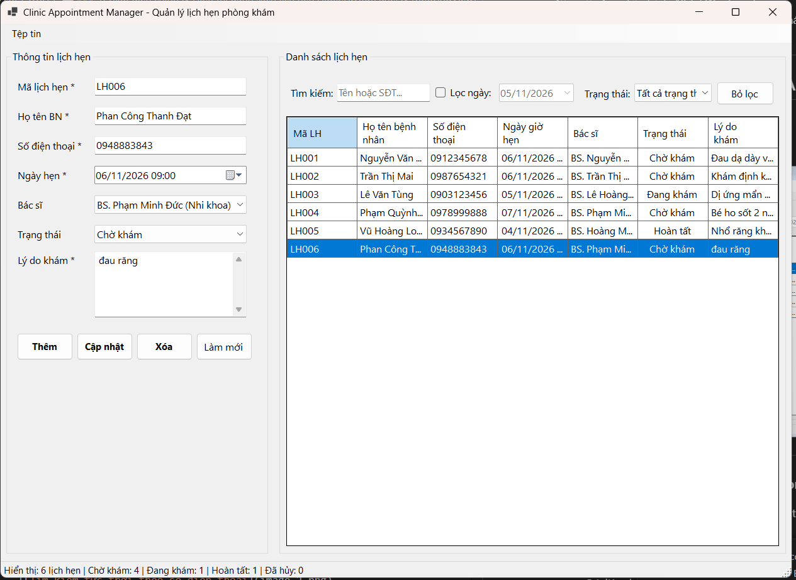
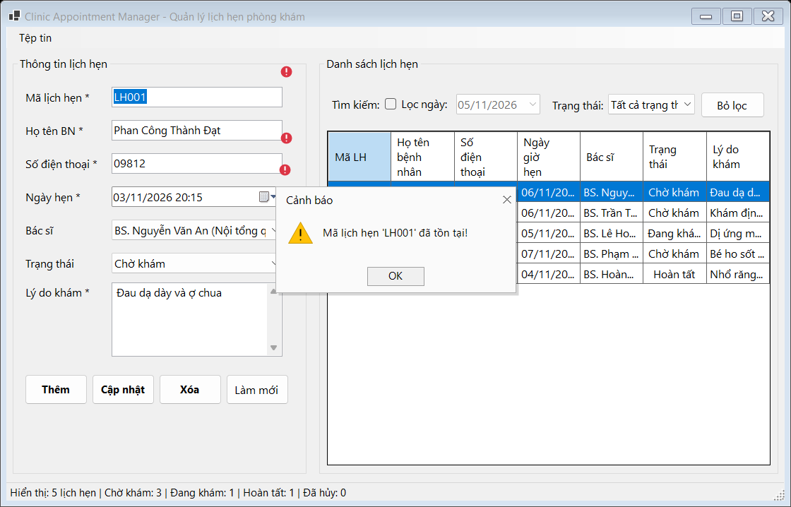
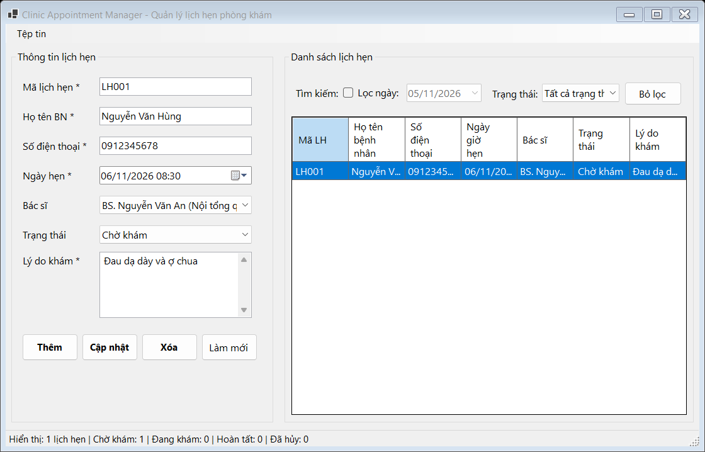
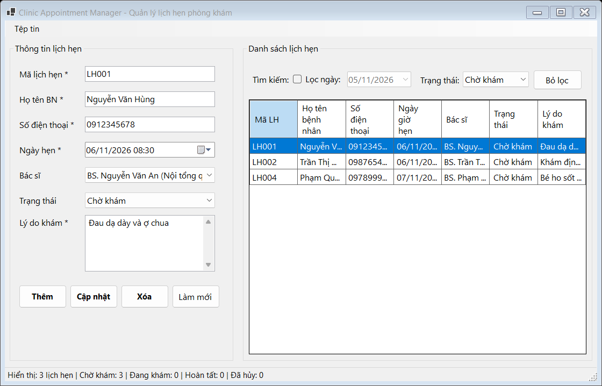

## THÔNG TIN SINH VIÊN
- **Họ và tên:** Phan Công Thành Đạt
- **Mã số sinh viên:** 24810310223
- **Lớp:** D19CNPM3
- **Tên môn học:** Lập trình .NET / Windows Forms
- **Tên bài tập:** Bài tập 1: Quản lý lịch hẹn phòng khám (Clinic Appointment Manager)

---

## DANH SÁCH ẢNH CHỤP MINH HỌA KẾT QUẢ

### 1. Giao diện chính & Hiển thị danh sách lịch hẹn (TableLayoutPanel & DataGridView)

---

### 2. Kiểm tra dữ liệu & Bắt lỗi Validation (ErrorProvider)

---

### 3. Tìm kiếm tức thời theo số điện thoại / Họ tên bệnh nhân

---

### 4. Lọc danh sách theo trạng thái & Thống kê trên StatusStrip

