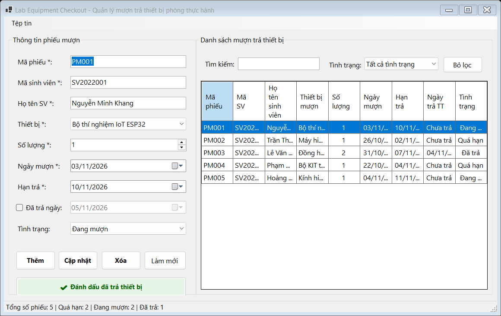
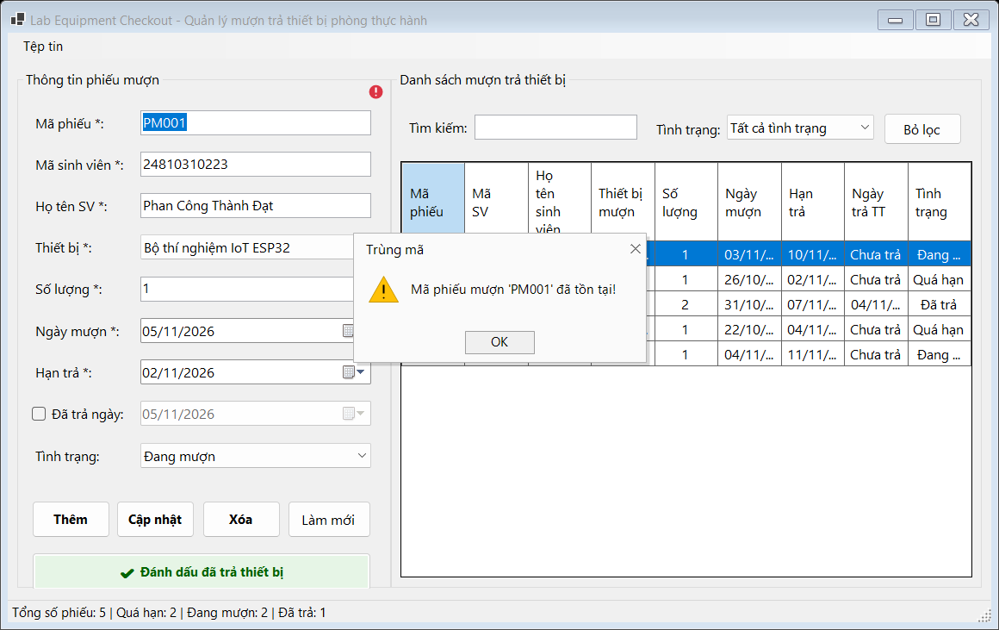
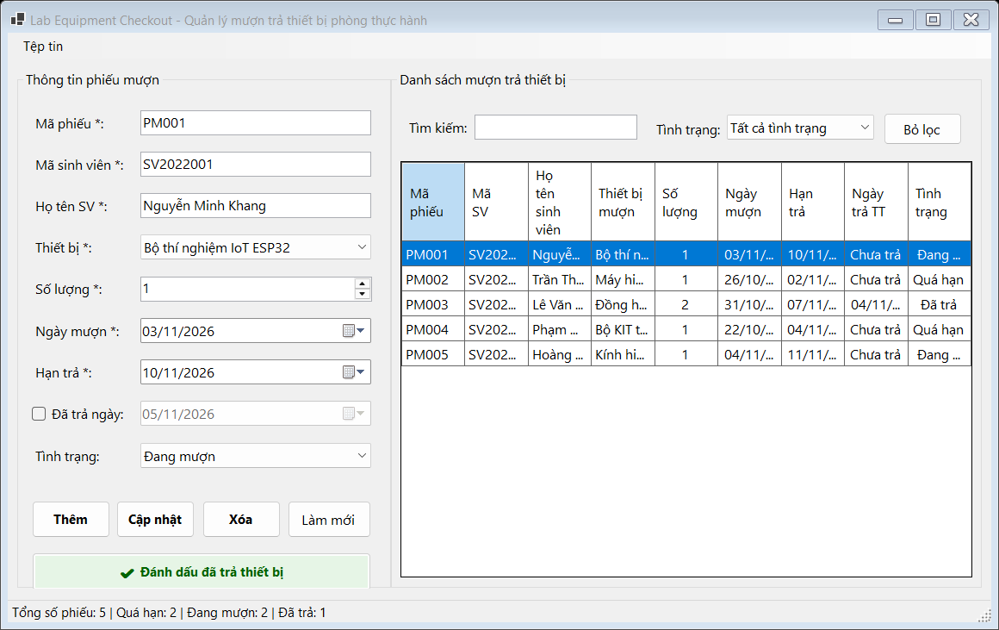
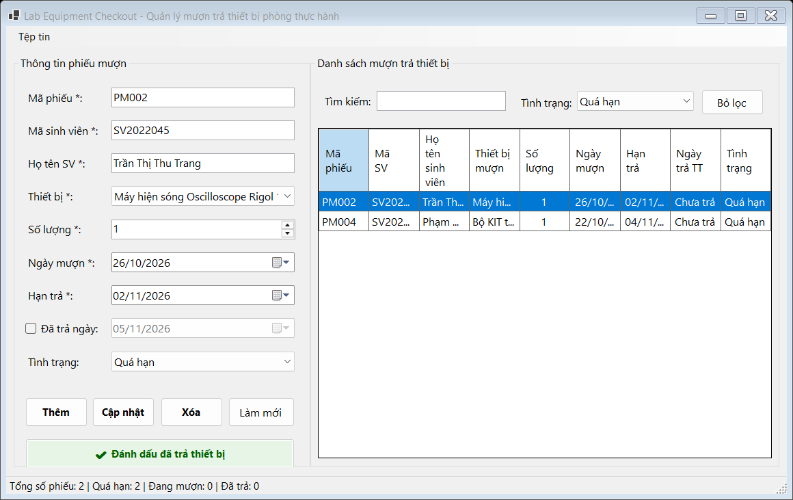

## THÔNG TIN SINH VIÊN
- **Họ và tên:** Phan Công Thành Đạt
- **Mã số sinh viên:** 24810310223
- **Lớp:** D19CNPM3
- **Tên môn học:** Lập trình .NET / Windows Forms
- **Tên bài tập:** Bài tập 2: Quản lý mượn trả thiết bị tại phòng thực hành (Lab Equipment Checkout)

---

## DANH SÁCH ẢNH CHỤP MINH HỌA KẾT QUẢ

### 1. Giao diện chính & Danh sách phiếu mượn thiết bị

---

### 2. Kiểm tra dữ liệu & Bắt lỗi Validation (ErrorProvider)

---

### 3. Thao tác xem, cập nhật và Đánh dấu đã trả thiết bị

---

### 4. Tìm kiếm tức thời & Lọc phiếu theo tình trạng "Quá hạn"

