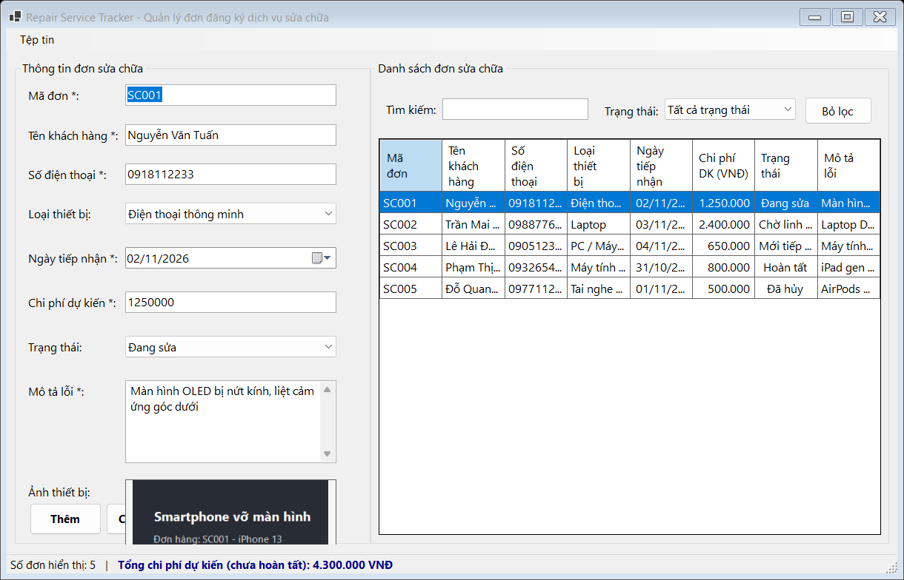
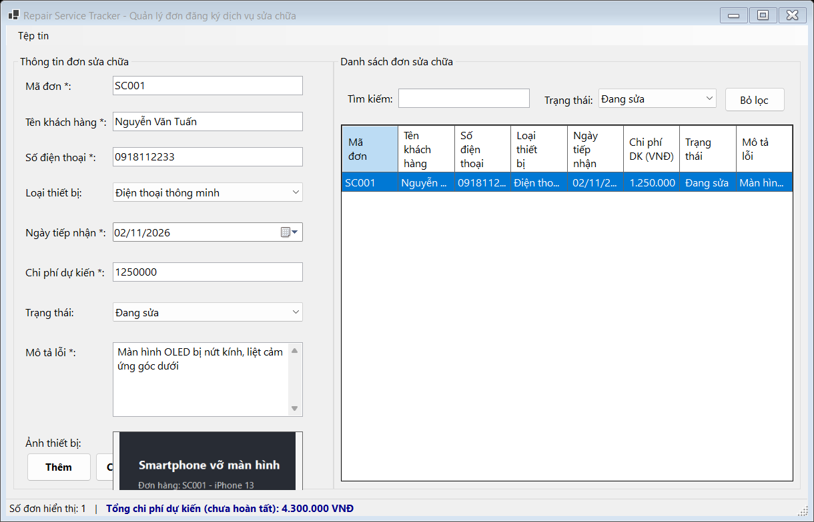

## THÔNG TIN SINH VIÊN
- **Họ và tên:** Phan Công Thành Đạt
- **Mã số sinh viên:** 24810310223
- **Lớp:** D19CNPM3
- **Tên môn học:** Lập trình .NET / Windows Forms
- **Tên bài tập:** Bài tập 3: Quản lý đơn đăng ký dịch vụ sửa chữa (Repair Service Tracker)

---

## DANH SÁCH ẢNH CHỤP MINH HỌA KẾT QUẢ

### 1. Giao diện chính, Hiển thị ảnh thiết bị Zoom & Định dạng chi phí "N0"

---

### 2. Kiểm tra dữ liệu & Bắt lỗi Validation (ErrorProvider)

---

### 3. Tìm kiếm tức thời theo Tên khách hàng / Mã đơn / SĐT

---

### 4. Lọc theo trạng thái & Tự động tính tổng chi phí chưa hoàn tất

